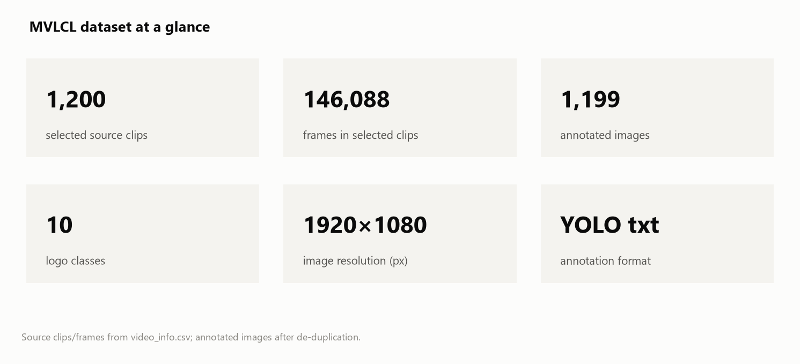
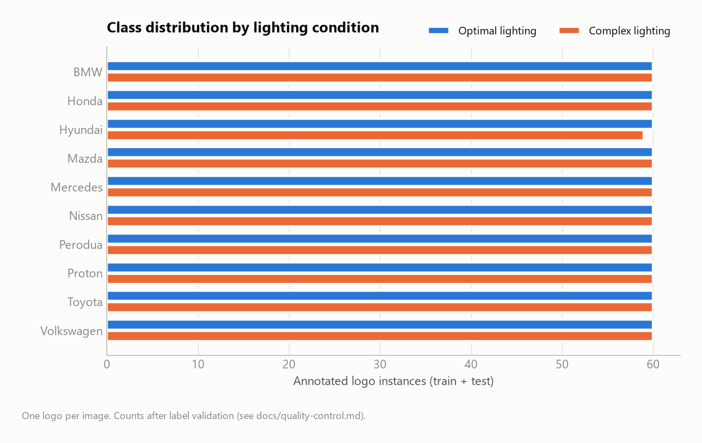
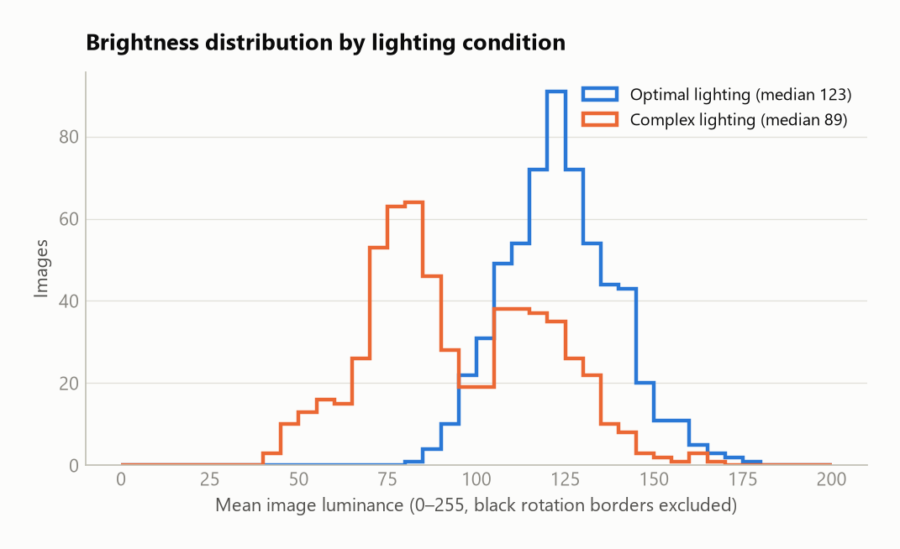
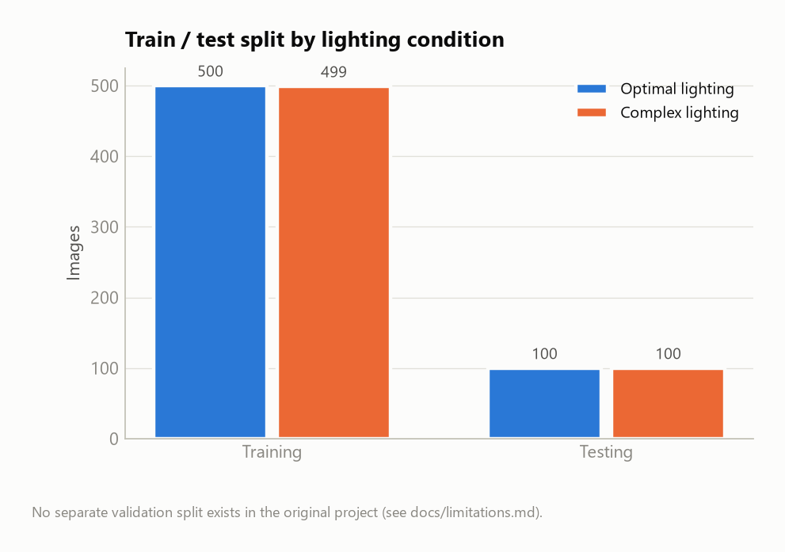
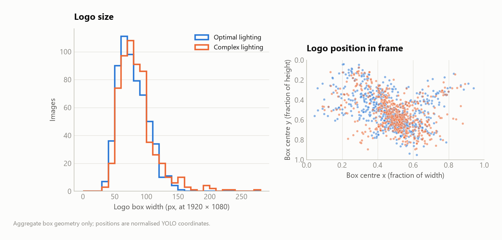
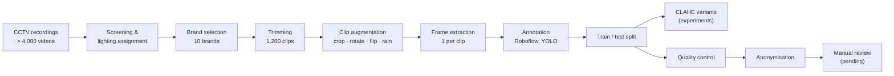
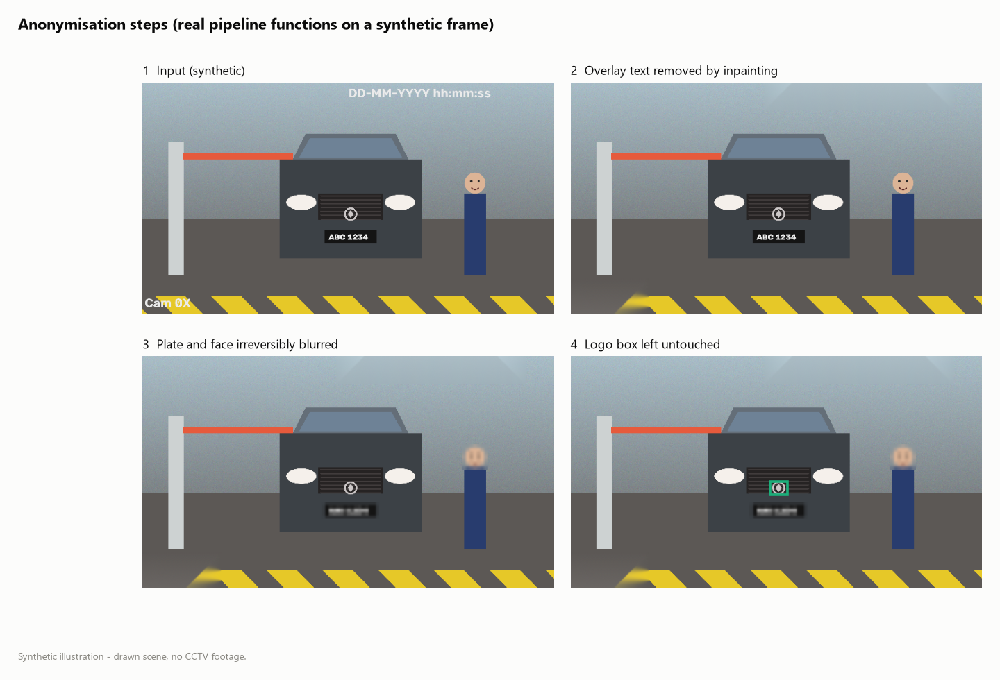
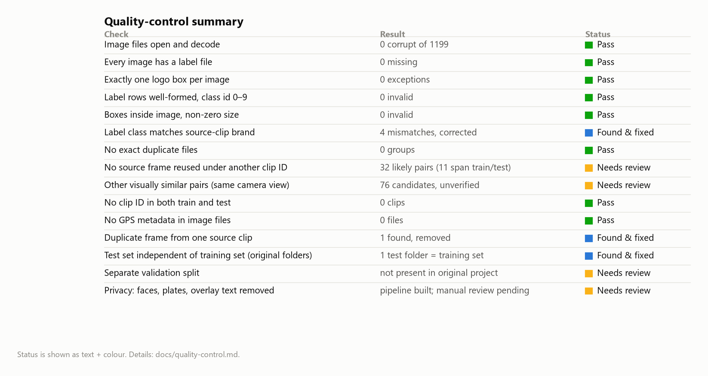

# MVLCL — Vehicle Logo Detection under Complex Lighting

**A CCTV dataset for detecting vehicle brand logos in difficult lighting, with its collection, annotation, quality-control and anonymisation pipeline documented end to end.**

> This repository provides public documentation, methodology, code and approved research visualisations. The original CCTV footage and restricted dataset files are not publicly distributed.

## Contents
- [Introduction](#introduction)
- [Dataset overview](#dataset-overview)
- [Dataset composition](#dataset-composition)
- [Data processing pipeline](#data-processing-pipeline)
- [Privacy and anonymisation](#privacy-and-anonymisation)
- [Quality assurance](#quality-assurance)
- [Limitations](#limitations)
- [Research usage and access](#research-usage-and-access)
- [Repository structure](#repository-structure)
- [Reproducing the analysis](#reproducing-the-analysis)
- [Computer Vision Model Implementation — Coming Soon](#computer-vision-model-implementation--coming-soon)

---

## Introduction

**MVLCL** (Malaysian Vehicle Logo Complex Lighting) was developed for a final-year computer science project on **vehicle logo recognition**. Vehicle logo recognition (VLR) complements licence-plate recognition in intelligent transportation systems, such as access control, parking management and traffic analytics. It must work in rain, at night and under glare, not just in good light.

| | |
|---|---|
| **Research objective** | Measure how detection degrades from optimal to complex lighting, and whether image enhancement (CLAHE) helps |
| **Task** | Object detection: one logo box per image, 10 brand classes |
| **Applications** | Vehicle brand identification at gates and car parks; supplementary vehicle attributes for ITS |
| **Scope of this repository** | Dataset development: collection, selection, augmentation, annotation, preprocessing, quality control, anonymisation and analytics |

## Dataset overview



| Property | Value |
|---|---|
| Raw recordings reviewed | > 4,000 CCTV videos *(per project report)* |
| Selected source clips | 1,200 (MP4, 1920 × 1080, 30 fps, 1.4–9.5 s) |
| Frames in selected clips | 146,088 |
| Annotated images | 1,199 JPEG, 1920 × 1080 |
| Classes | 10 vehicle brands |
| Annotation | 1 box per image, YOLO txt format, made in Roboflow |
| Split | Train 999 (500 optimal / 499 complex) · Test 200 (100 / 100) · no validation split |

## Dataset composition

**Classes:** BMW, Honda, Hyundai, Mazda, Mercedes, Nissan, Perodua, Proton, Toyota, Volkswagen. A class is the brand of the logo on the front of the vehicle passing the barrier. The classes are balanced by design, at 59–60 images per class per lighting condition.

**Lighting conditions:**
- **Optimal:** daytime, even light.
- **Complex:** night, rain, low or strong light, glare, blur.

The median image luminance is 123 for optimal and 89 for complex.

| Class distribution | Brightness by condition |
|---|---|
|  |  |

| Train / test split | Annotation geometry |
|---|---|
|  |  |

Logos are small objects: the median box is 77 × 75 px in a 1920 × 1080 frame. Details are in [docs/dataset-overview.md](docs/dataset-overview.md) and [docs/annotation-guidelines.md](docs/annotation-guidelines.md).

## Data processing pipeline



| Stage | Done in | Documentation |
|---|---|---|
| Collection, screening, trimming | Original project | [data-collection.md](docs/data-collection.md) |
| Clip-level augmentation, frame extraction | Original project | [data-preprocessing.md](docs/data-preprocessing.md) |
| Annotation | Original project | [annotation-guidelines.md](docs/annotation-guidelines.md) |
| CLAHE enhancement (HSV V channel, MSE/PSNR) | Original project | [data-preprocessing.md](docs/data-preprocessing.md#clahe-enhancement-experimental-variants) |
| Quality control, analytics | This repository | [quality-control.md](docs/quality-control.md) |
| Anonymisation | This repository | [anonymisation-methodology.md](docs/anonymisation-methodology.md) |

## Privacy and anonymisation

The footage comes from a residential community's entrance cameras. It was used with the management's permission, on the condition that the site isn't named.

**What's published:**
- No footage, frame, crop or thumbnail of the source data is published.
- All visual examples here are **synthetic drawings**.

**The anonymisation pipeline built for the dataset:**
- **removes** burned-in timestamps, camera labels and other text by inpainting
- **blurs** licence plates and faces irreversibly, with a safety blur around the logo when no plate is detected
- leaves the annotated logo untouched
- strips file metadata.



**Status:** the pipeline is implemented and tested; the full run and the **manual review of every image are still outstanding**. Anonymisation reduces risk, but it is **not** a claim of complete anonymity or legal compliance, and it doesn't create permission to redistribute. See [privacy-and-ethics.md](docs/privacy-and-ethics.md).

## Quality assurance



**Implemented and passed:**
- integrity and dimensions of every image
- one valid, in-bounds box per image
- class ids
- no exact duplicates
- no clip ID shared between train and test
- no EXIF or GPS metadata

**Found and fixed:**
- 4 label/brand mismatches
- 1 duplicate frame
- an experiment "test" folder identical to its training folder

**Flagged, not fixed:**
- **32 likely reused source frames** under different clip IDs. 11 of these span train and test, and 13 span the two lighting conditions (synthetic rain added to daytime frames).
- 76 visually similar candidate pairs, unverified.
- a metadata naming error in the clip index
- a lineage gap between clips and annotated images.

Full method and results are in [quality-control.md](docs/quality-control.md).

## Limitations

- **Small dataset from a single site:** 1,199 images, a few fixed cameras.
- **Logos are small:** about 4 % of the frame width.
- **Some "complex lighting" frames are synthetic rain** over daytime footage.
- **Train/test leakage** through reused source frames.
- **No validation split.**
- **Lighting labels were assigned by hand.**
- **Undocumented frame-selection and augmentation details.**

See [limitations.md](docs/limitations.md).

## Research usage and access

This repository provides public documentation, methodology, code and approved research visualisations. The original CCTV footage and restricted dataset files are not publicly distributed.

Access to the underlying dataset is subject to the data owner's permission. **No public access process exists at present**, and none should be assumed.

The code is usable on any YOLO-format dataset:
- `dataset_analysis.py` (statistics and QC)
- `preprocessing.py` (CLAHE)
- `anonymization.py` (privacy pipeline)

## Repository structure

```
├── README.md
├── LICENSE
├── requirements.txt
├── docs/                      dataset documentation (8 files)
├── analytics/                 aggregate charts + dataset_statistics.json, quality_report.json
├── visualizations/            synthetic illustrations + generate_synthetic_figures.py
│   ├── annotation-examples/
│   └── preprocessing-examples/
├── scripts/
│   ├── dataset_analysis.py    statistics, QC checks, charts
│   ├── preprocessing.py       CLAHE enhancement + MSE/PSNR
│   ├── anonymization.py       text removal, plate/face blur, metadata stripping
│   └── review_contact_sheet.py  pages for the manual privacy review
└── examples/README.md         why no real images are included
```

## Reproducing the analysis

The scripts need access to the restricted data (or any dataset in the same YOLO layout). Paths are always passed as arguments, never stored in code.

```bash
pip install -r requirements.txt

# statistics, QC checks and charts (aggregate output only)
python scripts/dataset_analysis.py --images DATA/images --labels DATA/labels \
    --video-info DATA/video_info.csv --out analytics/

# CLAHE variants (writes to a separate folder; sources are never overwritten)
python scripts/preprocessing.py fixed DATA/images/test/complex OUT/clahe_default --report clahe.csv

# anonymisation + manual-review pages (keep outputs private)
python scripts/anonymization.py --images DATA/images --labels DATA/labels --out OUT/anon \
    --work OUT/work --plate-weights PLATE_MODEL.pt
python scripts/review_contact_sheet.py --images OUT/anon --detections OUT/work/detections.json --out OUT/review

# synthetic figures (no data needed)
python visualizations/generate_synthetic_figures.py
```

**Tested with:** Python 3.11, NumPy 2.4, OpenCV 5.0, Matplotlib 3.11, deface 1.5, EasyOCR 1.7, Ultralytics 8.4.

## Computer Vision Model Implementation — Coming Soon

Model development will be published in a **separate repository**, linked here once available. It will cover:

- **Model architecture:** YOLO-family detectors
- **Training methodology:** including a group-aware split and a validation set, addressing the leakage documented above
- **Hyperparameter configuration**
- **Model evaluation and metrics:** precision, recall, mAP and inference time, reported separately for optimal, real complex and synthetic-rain frames
- **Inference demonstrations**
- **Error analysis**

None of these stages is presented here as complete. This repository's [`analytics/dataset_statistics.json`](analytics/dataset_statistics.json) and documented splits are intended as the dataset reference for that work.

## Licence and citation

- **Documentation and figures:** CC BY 4.0.
- **Code:** MIT. See [LICENSE](LICENSE).
- **Dependencies:** `anonymization.py` uses Ultralytics (AGPL-3.0); see the note in LICENSE.
- **Trademarks:** vehicle logos are trademarks of their respective owners.

```bibtex
@misc{mvlcl_showcase,
  author = {Aryssa Amanda Azhar},
  title  = {MVLCL: Vehicle Logo Detection under Complex Lighting -- Dataset Documentation},
  year   = {2026},
  url    = {https://github.com/amndazhar/mvlcl-vehicle-logo-dataset}
}
```
