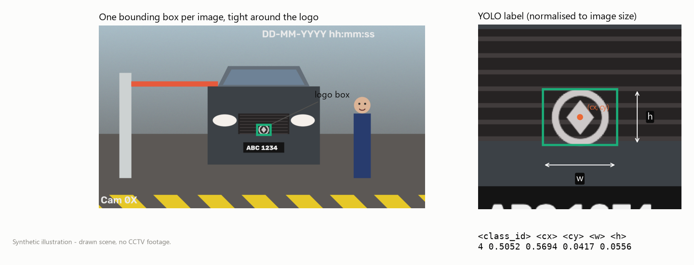

# Annotation guidelines

These guidelines are reconstructed from the label files and the project report. Points not stated in the project are marked as such.

## Task

Draw **one axis-aligned bounding box around the brand logo on the front of the vehicle** that is passing the barrier, and assign the brand class.



## Rules

| Rule | Basis |
|---|---|
| Exactly one box per image: the logo of the vehicle being recorded | Confirmed. All 1,199 label files contain exactly one box |
| Box tightly encloses the visible emblem (badge outline), not the grille | Inferred from the box sizes (median 77 × 75 px at 1920 × 1080) |
| Class is the brand of the emblem, whatever the model or colour | Confirmed (class list) |
| Logos on other vehicles in the background are not annotated | Inferred from the one-box rule; **not stated** in the project |
| Unreadable or ambiguous logos: kept with the brand of the clip | Inferred. Some complex-lighting logos can't be identified visually; the clip's brand folder was the source of truth |

## Classes

`0 BMW, 1 Honda, 2 Hyundai, 3 Mazda, 4 Mercedes, 5 Nissan, 6 Perodua, 7 Proton, 8 Toyota, 9 Volkswagen`

## Format

YOLO text format, one file per image with the same name, one line per box:

```
<class_id> <x_centre> <y_centre> <width> <height>
```

All four coordinates are normalised to [0, 1] by the image width and height. Images are 1920 × 1080.

## Tooling

Annotation was done in **Roboflow** and exported in YOLO format. One exported filename still carries the Roboflow export suffix. The annotator and any double-annotation or inter-annotator agreement are **undocumented**; a single annotator is assumed.

## Validation applied

| Check | Outcome |
|---|---|
| Label file exists for every image | 1,199 / 1,199 |
| Row has 5 fields; class id 0–9 | All valid |
| Box inside the image and non-zero size | All valid |
| Label class matches the brand of the source clip | **4 mismatches** (2 Proton labelled Perodua, 2 Mazda labelled Nissan), corrected to the clip brand |

The logos in the four corrected images couldn't be confirmed visually because of the lighting. They were corrected on the basis that the clip's brand folder is authoritative. See [quality-control.md](quality-control.md).

## Recommendations for future annotation

- Write the guidelines down **before** annotating, including rules for partially visible, occluded and unreadable logos.
- Double-annotate a sample (for example 10 %) and report agreement (IoU and class agreement).
- Record the extracted frame number, so each image can be traced back to its clip.
