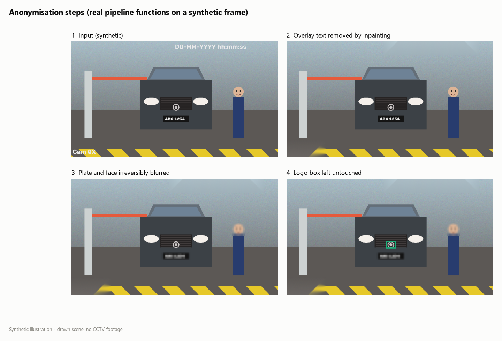

# Anonymisation methodology

The source images are CCTV frames of vehicles at a residential entrance. They can contain **licence plates, faces, burned-in date/time stamps and camera labels**, plus signs or other text. This document describes the anonymisation pipeline built for the dataset and its current status.

> **Status: the pipeline is implemented and tested. The final run over all images and the manual review are not yet complete.** No anonymised image is published in this repository. Anonymisation lowers the risk of re-identification, but it **does not on its own grant permission to redistribute** footage; see [privacy-and-ethics.md](privacy-and-ethics.md).



## What is removed, and how

| Content | Detection | Treatment |
|---|---|---|
| CCTV date/time stamp and camera label | **By position.** The overlay sits at a fixed place in the camera frame, and that region is mapped through each image's known augmentation (flip, 180° rotation, or ±20°/30° rotation, whose direction is found by matching the black corners). For crops, where the position isn't recorded, a row-of-characters detector runs in the top band and bottom-left, and bright text strokes in the top-right corner are always removed | **Removed** by inpainting (OpenCV Telea), so the text disappears instead of leaving a smudge |
| Any other text, including plate characters | EasyOCR's CRAFT text detector (detection only, no reading), run on the original, a brightened copy and the de-rotated image | **Removed** by inpainting along the text's slanted outline |
| Licence plates | YOLO licence-plate detector on the original, a brightened copy and the de-rotated image. Low confidence threshold (0.1) | Irreversible blur: pixelate to 1/16 resolution, then Gaussian blur |
| Faces | CenterFace (via `deface`) on the original and a brightened copy. Threshold 0.2 | Irreversible blur |
| Plate missed next to the logo | If no plate box lies within about 4 logo-heights of the logo, a **safety window** of ±3.5 logo sizes is blurred around it | Irreversible blur |
| Anything found in manual review | Reviewer adds a box to `manual_blur.csv` | Irreversible blur |
| File metadata | — | Image re-encoded without EXIF or GPS |

**Logo protection.** Pixels inside the annotated logo box are never changed, so the labels stay valid.

**Over-removal by design.** Thresholds are low, boxes are enlarged by 15 %, and the oversized-box cap is set to drop only implausible detections. A false positive costs a little background quality; a false negative would expose personal data.

## Validation so far

| Check | Result |
|---|---|
| Overlay geometry on rotated frames | Predicted black corners match the image (IoU 1.00 on every sample) |
| Overlay removal on rotated, flipped and plain frames | Timestamp and camera label fully removed on all samples checked |
| Overlay removal on cropped frames | Crops with visible timestamps had them removed; crops without timestamps were left unchanged in the samples checked |
| Plates: first version (plate model only) | Missed many plates on dark and rotated frames, so text detection, brightened and de-rotated passes and the safety window were added |
| Published script vs. working pipeline | Pixel-identical output on a test image |
| EXIF / GPS in output | None |

## Known limitations

- **Automatic detection is not complete.** Partial plates, plates at steep angles, and faces in the dark or through windscreens can be missed. **Manual review of every image is required** before any image could be considered for release. `review_contact_sheet.py` produces 16-image review pages for this.
- **Over-removal changes the images.** Safety windows and inpainting alter background regions, which may affect models trained on the anonymised images.
- **Re-identification isn't only about plates and faces.** Vehicle make, colour, damage, stickers, the site layout and the timing of the footage can still identify people. This is one reason the showcase publishes no images at all.
- The licence-plate model is a third-party model (AGPL-3.0) and is not included here.

## Running it

```bash
python scripts/anonymization.py --images RAW_IMAGES --labels LABELS --out ANONYMISED \
    --work WORK_DIR --plate-weights PLATE_MODEL.pt [--manual manual_blur.csv]
python scripts/review_contact_sheet.py --images ANONYMISED \
    --detections WORK_DIR/detections.json --out REVIEW_DIR
```

- The run is resumable: re-running skips images already processed.
- Processing takes about 20–30 s per 1080p image on a laptop CPU. A CUDA GPU is much faster.
- Review pages contain restricted imagery and **must stay private**.
