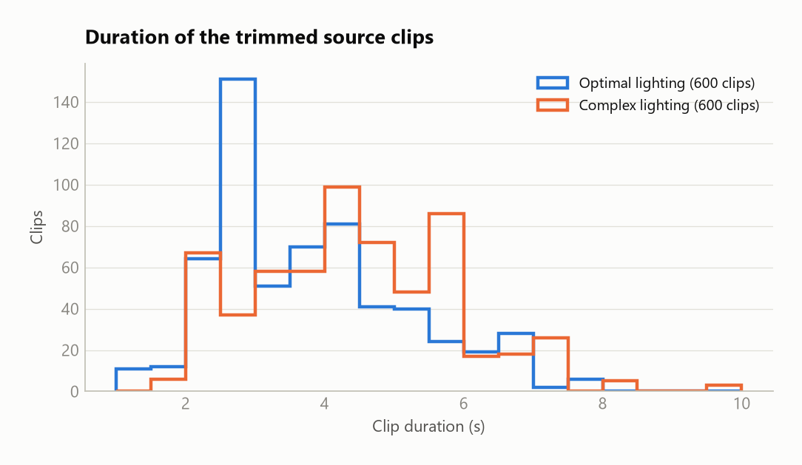

# Data collection

## Source

| Aspect | Description | Status |
|---|---|---|
| Recording system | Fixed CCTV cameras at the vehicle entrance of a residential community, triggered by motion | Confirmed (report; footage shows a boom barrier and camera overlay) |
| Cameras | At least two fixed viewpoints | Confirmed (camera labels in the footage; the IDs aren't published) |
| View | Front of the vehicle while it passes the barrier | Confirmed |
| Period | Footage from several days, covering day, night and rain | Confirmed (overlay timestamps; exact dates intentionally not published) |
| Permission | Requested from and granted by the community's management, **on condition the community is not named** | Confirmed (project report) |
| Scope of permission | Use for the academic project. **Redistribution is not documented.** | See [privacy-and-ethics.md](privacy-and-ethics.md) |

The site's name, location, camera identifiers and recording dates are deliberately left out of this repository.

## Collection and selection

1. **Retrieval.** Historical recordings were downloaded over several periods of the day so that both lighting regimes are represented. The report records more than 4,000 videos in MP4 or AVI.
2. **Relevance screening.** Every video was reviewed by hand.
   - Clips without a vehicle were discarded. The motion trigger also recorded animals, flags and leaves.
   - Clips showing the rear of a vehicle were discarded.
3. **Lighting assignment.** The remaining clips were sorted by hand into:
   - **optimal**: daytime, even light
   - **complex**: night, rain, low or strong light, glare, blur
4. **Brand selection.** Up to 19 brands appeared. Brands with too few clips were dropped, leaving 10 brands common in Malaysia.
5. **Trimming.** Each clip was cut to the moment the vehicle passes the gate. The resulting clips last 1.4–9.5 s.

## What is documented and what is not

| Item | Status |
|---|---|
| Number of raw videos (> 4,000) | Reported, but the raw collection isn't part of the project files |
| Selection criteria (front view, vehicle present, brand frequency) | Documented in the report |
| Criterion separating optimal from complex | Described qualitatively only; no numerical rule |
| Recording tool and trimming tool | **Undocumented** |
| Raw resolution | **Inconsistent.** The report states 720p; every selected clip is 1920 × 1080. The clips may have been upscaled during trimming or augmentation — unverified |
| Number of vehicles, number of unique vehicles | **Undocumented**. The same vehicle can appear in several clips |
