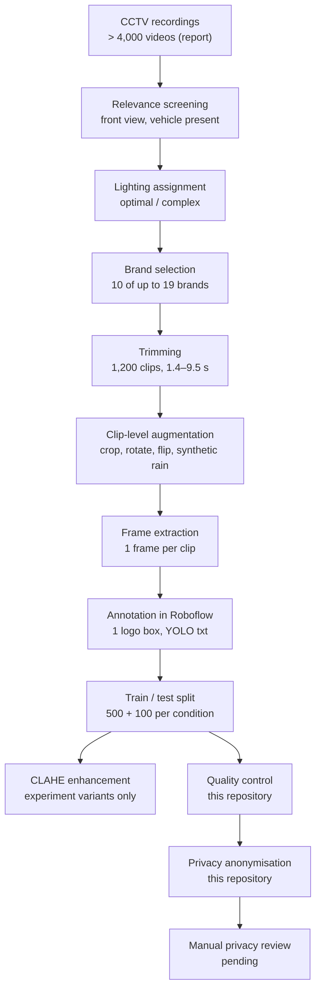
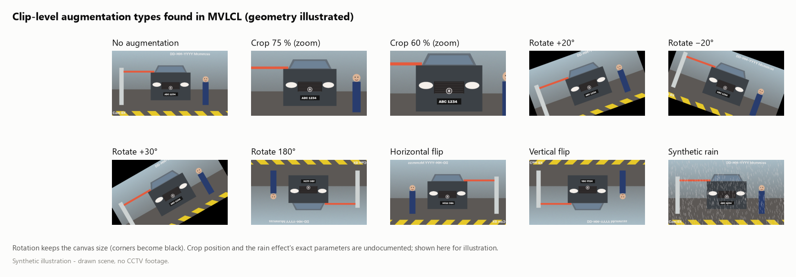
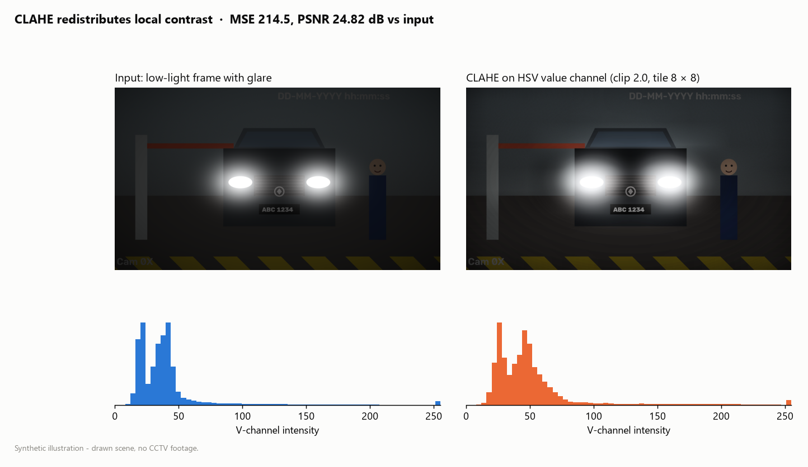

# Data preprocessing

## Pipeline

Steps A–J were carried out in the original project. Steps K–M were added afterwards to prepare this showcase; they are described in [quality-control.md](quality-control.md) and [anonymisation-methodology.md](anonymisation-methodology.md).

## Clip-level augmentation

Augmentation was applied to whole clips **before** frames were extracted. Each augmented clip got a new clip ID, and the augmentation is recorded as a filename suffix.

| Suffix | Operation | Notes |
|---|---|---|
| `crop60`, `crop75` | Crop to 60 % or 75 % of the frame and scale back to full size (zoom) | Crop position not recorded; some crops come from rotated footage |
| `rotate20`, `rotate30`, `rotate_neg20` | Rotate about the centre on the same 1920 × 1080 canvas; corners become black | Confirmed from the corner geometry (fit IoU 1.00) |
| `rotate180`, `flipH`, `flipV` | 180° rotation, horizontal and vertical mirror | `flipV` and `rotate180` exist in the clips but aren't listed in the report |
| `rain` | Synthetic rain overlay | Complex-lighting set only; generator undocumented |

**Consequence.** Augmented clips are derived from other clips in the collection, so the 1,200 clips are **not 1,200 independent recordings**. Quality control found 32 likely pairs of the same source frame under different clip IDs, 11 of which span train and test; see [quality-control.md](quality-control.md#reused-source-frames).

## Frame extraction

One frame per clip was kept and annotated. The rule for choosing which frame is **undocumented**.

### Lineage between clips and annotated images

Annotated image names follow the clip naming scheme `<clipID>_<CD|UD>_<Brand>[_<aug>]`. Matching them against the submitted clip collection gives:

| Match | Images |
|---|---|
| Image name matches a clip name exactly | 428 |
| Same clip number and brand, different augmentation suffix | 715 |
| No clip with that number and brand | 56 |

The annotated images and the submitted clip collection therefore appear to come from **different versions** of the clip set. The frame-to-clip lineage can't be fully reconstructed from the project files. For example, vertical-flip clips exist, but no annotated frame carries a `flipV` suffix.

## CLAHE enhancement (experimental variants)

To test whether image enhancement helps detection under complex lighting, enhanced copies of the complex-lighting images were made with **Contrast Limited Adaptive Histogram Equalisation (CLAHE)**. These are experiment variants; the base dataset is unenhanced.

| Variant | Setting | Applied to |
|---|---|---|
| Default | clip limit 2.0, 8 × 8 tile grid | complex-lighting images |
| "Best parameter" | per image, the setting with the highest PSNR versus the original, from clip {1.5, 2.0, 2.5} × tile {8, 16, 32} | complex-lighting images |

**Method.** Convert BGR to HSV, apply CLAHE to the **V channel** only, then convert back. Hue and saturation are untouched. Quality is measured as **MSE** and **PSNR** against the input.

**Measured effect.** Default CLAHE on the 500 complex-lighting training images gave MSE 70–93 and PSNR 28.5–29.7 dB.

**Caveat.** The highest PSNR against the original is the *smallest change*. The "best parameter" search therefore almost always chose the mildest setting (clip 1.5, tile 32 × 32), which may not be the most useful for detection. A task-driven criterion, such as validation mAP, is recommended.

Implementation: [`scripts/preprocessing.py`](../scripts/preprocessing.py).

## Scripts

| Script | Purpose | Input | Output |
|---|---|---|---|
| [`preprocessing.py`](../scripts/preprocessing.py) | CLAHE on the HSV V channel; fixed or grid mode; MSE/PSNR report | folder of JPEGs | enhanced JPEGs in a **different** folder, optional CSV |
| [`dataset_analysis.py`](../scripts/dataset_analysis.py) | Statistics, QC checks, charts | YOLO image + label roots, optional `video_info.csv` | PNG charts, `dataset_statistics.json`, `quality_report.json` |
| [`anonymization.py`](../scripts/anonymization.py) | Privacy anonymisation | raw images, labels, plate model | anonymised JPEGs, per-image detection JSON, review log |
| [`review_contact_sheet.py`](../scripts/review_contact_sheet.py) | Manual-review pages | anonymised images + `detections.json` | 16-image review pages (keep private) |

Example commands are in the [README](../README.md#reproducing-the-analysis).
