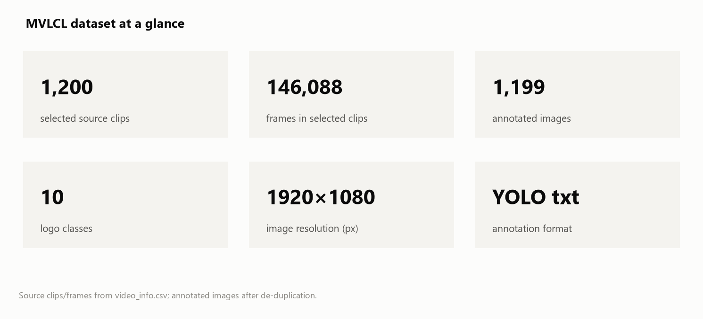
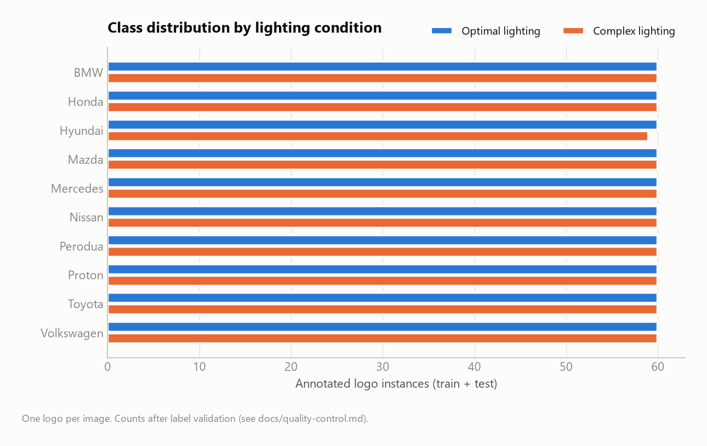
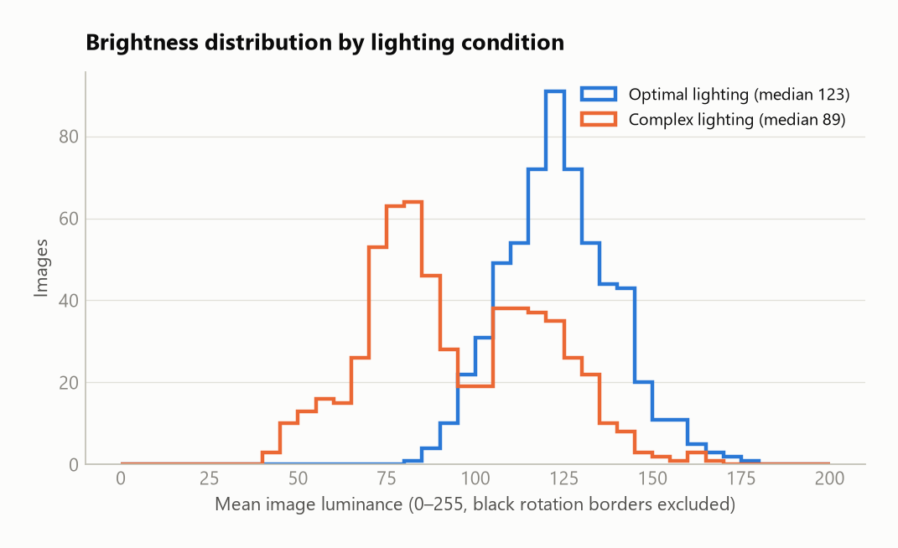
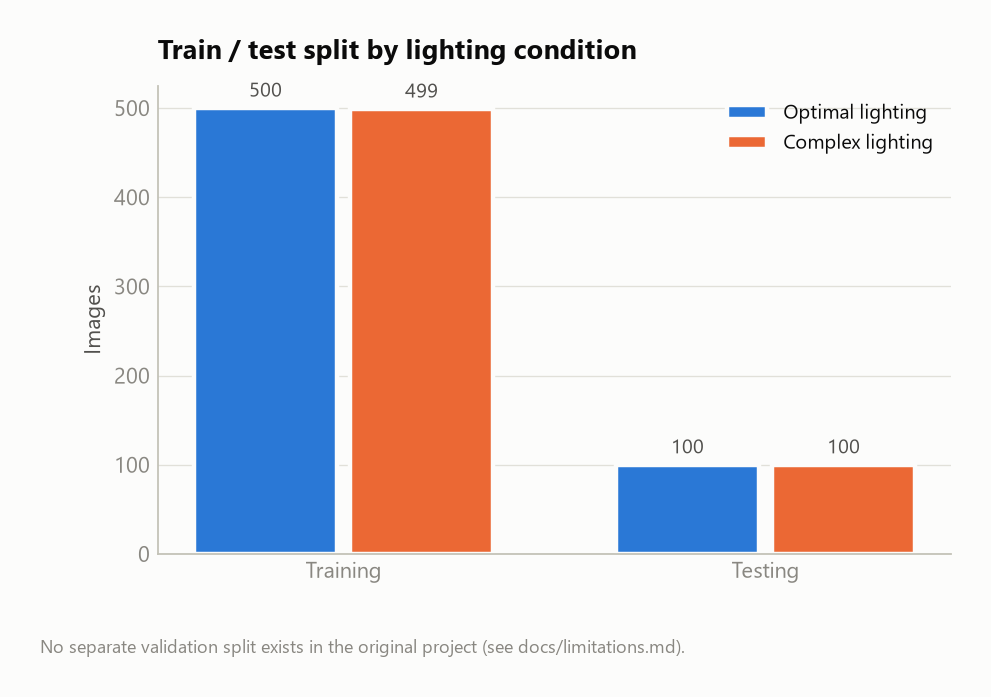
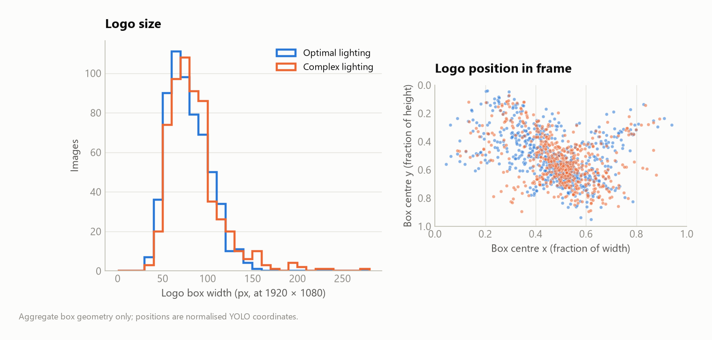
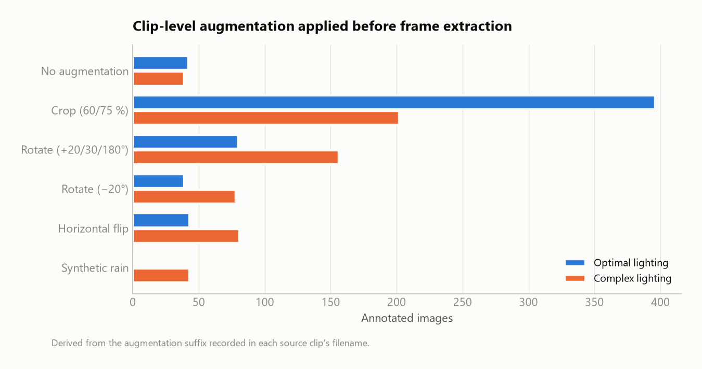

# Dataset overview

**MVLCL — Malaysian Vehicle Logo Complex Lighting dataset.** It contains front-view frames of vehicles at a residential vehicle entrance, recorded by fixed CCTV cameras. Each frame is annotated with a bounding box around the vehicle's brand logo. The dataset was built to study **logo detection under optimal versus complex lighting**.

> The images and source footage are **not distributed** in this repository. Everything below is computed from the private dataset and published only as aggregate figures. See [privacy-and-ethics.md](privacy-and-ethics.md).

## At a glance

| Property | Value | Source |
|---|---|---|
| Raw recordings reviewed | > 4,000 videos (MP4/AVI) | Project report (not re-verifiable here) |
| Brands observed in raw footage | up to 19 | Project report |
| Selected, trimmed source clips | **1,200** (600 optimal, 600 complex) | `video_info.csv` |
| Frames in selected clips | **146,088** | `video_info.csv` |
| Clip format | MP4, 1920 × 1080, 30 fps, 1.4–9.5 s | `video_info.csv` |
| Annotated images | **1,199** (1,200 minus 1 duplicate) | Dataset files |
| Image format | JPEG, 1920 × 1080 (all images) | Dataset files |
| Classes | **10** logo brands | Label files |
| Boxes per image | exactly 1 | Label files |
| Annotation format | YOLO txt (`class cx cy w h`, normalised) | Label files |
| Annotation tool | Roboflow | Project report and file naming |



## Classes

| ID | Class | Optimal | Complex | Total |
|---|---|---|---|---|
| 0 | BMW | 60 | 60 | 120 |
| 1 | Honda | 60 | 60 | 120 |
| 2 | Hyundai | 60 | 59 | 119 |
| 3 | Mazda | 60 | 60 | 120 |
| 4 | Mercedes | 60 | 60 | 120 |
| 5 | Nissan | 60 | 60 | 120 |
| 6 | Perodua | 60 | 60 | 120 |
| 7 | Proton | 60 | 60 | 120 |
| 8 | Toyota | 60 | 60 | 120 |
| 9 | Volkswagen | 60 | 60 | 120 |

A class is the **brand of the vehicle's front logo**. The 10 brands are the ones with enough clips among the up-to-19 brands seen in the raw footage. The dataset is balanced by design: 60 clips per brand per lighting condition.



## Lighting conditions

| Condition | Definition (from the project) | Median image luminance* |
|---|---|---|
| **Optimal** | Daytime footage with clear, even lighting | 123 / 255 |
| **Complex** | Night-time, rain, low light, strong light, glare and blur | 89 / 255 |

\*Mean grey level per image, excluding the black borders created by rotation, then the median over images.



The complex-lighting distribution is **bimodal**. One peak is dark night-time footage. The other overlaps the daylight range: it comes from daytime glare and rain scenes, and from optimal frames with synthetic rain added (see [quality-control.md](quality-control.md#reused-source-frames)).

## Splits

| Split | Optimal | Complex | Total |
|---|---|---|---|
| Train | 500 | 499 | 999 |
| Test | 100 | 100 | 200 |
| Validation | — | — | **none** |

- Each test split has exactly 10 images per class. No clip ID appears in both train and test.
- There is **no validation split**; see [limitations.md](limitations.md).



## Annotation geometry

| Statistic | Value |
|---|---|
| Logo box width | min 30 px, median 77 px, 90th percentile 113 px, max 270 px (at 1920 px width) |
| Relative size | median logo is about 4 % of the frame width |
| Implication | at a 256 px training resolution, a median logo is about **10 px wide** |



## Augmentation

Augmentation was applied to the **video clips before frame extraction**. The type is recorded as a filename suffix.

| Type | Optimal images | Complex images |
|---|---|---|
| None | 42 | 39 |
| Crop (60 % / 75 % zoom) | 396 | 202 |
| Rotate +20° / +30° / 180° | 80 | 156 |
| Rotate −20° | 39 | 78 |
| Horizontal flip | 43 | 81 |
| Synthetic rain | — | 43 |



The source clips also include vertical flips and 180° rotations. No vertical-flip frames appear in the annotated set (see [data-preprocessing.md](data-preprocessing.md#lineage-between-clips-and-annotated-images)).

## Folder layout (private dataset)

```
images/{train,test}/{optimal,complex}/<lighting>_<Brand>_<clipID>[_<augmentation>].jpg
labels/{train,test}/{optimal,complex}/<same name>.txt
```

The machine-readable figures are in [`analytics/dataset_statistics.json`](../analytics/dataset_statistics.json). They are regenerated by [`scripts/dataset_analysis.py`](../scripts/dataset_analysis.py).
