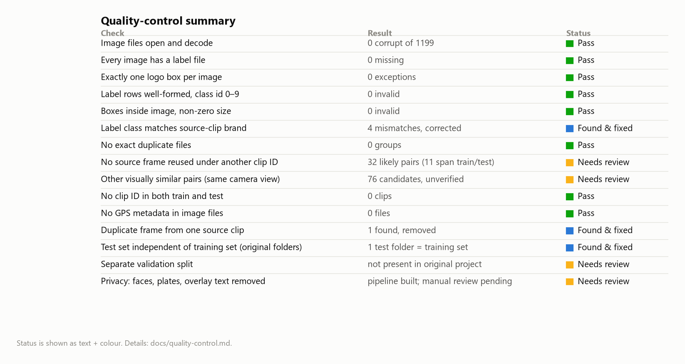

# Quality control

All automated checks are implemented in [`scripts/dataset_analysis.py`](../scripts/dataset_analysis.py) and are reproducible. Results: [`analytics/quality_report.json`](../analytics/quality_report.json).

## Implemented checks and results

| # | Check | Method | Result |
|---|---|---|---|
| 1 | Corrupted images | Pillow `verify()` + full decode | 0 of 1,199 |
| 2 | Image dimensions | Read size of every image | all 1920 × 1080 |
| 3 | Missing annotations | Label file per image | 0 missing |
| 4 | Boxes per image | Count label rows | exactly 1 in every image |
| 5 | Malformed labels / invalid class ids | 5 numeric fields, class 0–9 | 0 |
| 6 | Invalid bounding boxes | Box non-empty and inside [0, 1] | 0 |
| 7 | Label vs. source brand | Label class compared with the brand of the source clip | **4 mismatches → corrected** |
| 8 | Exact duplicate files | MD5 of file bytes | 0 |
| 9 | Duplicate frame from the same clip | Two exported frames of one clip | **1 found → removed** |
| 10 | Clip ID in both train and test | Clip ID per split | 0 |
| 11 | Reused source frames | Perceptual hash; see below | **32 likely pairs, 11 spanning train/test → flagged** |
| 12 | Visually similar frames | Perceptual hash; see below | 76 candidate pairs, unverified |
| 13 | Embedded metadata | EXIF/GPS tags in each JPEG | 0 images with EXIF or GPS |
| 14 | Train/test independence of experiment folders | Byte comparison of folders | **1 test folder identical to its training folder → excluded** |
| 15 | Metadata consistency | `video_info.csv` vs. files on disk | **60 rows with wrong clip names → documented** |
| 16 | Clip-to-image lineage | Image names vs. clip names | **Only 428 / 1,199 names match → documented** |

## Findings in detail

### Label corrections (check 7)
Four labels named a different brand from their clip:
- two Proton frames labelled Perodua
- two Mazda frames labelled Nissan

The logos are unreadable in these complex-lighting frames, so the clip's brand folder was treated as authoritative and the labels were corrected. After correction every test split has exactly 10 images per class.

### Reused source frames (checks 11–12) 
A 256-bit difference hash (dHash) of the **central 60 %** of each frame was compared across all pairs. The centre is used because every rotated frame has the same black corners, which otherwise make unrelated images look alike.

- **Likely reuse**: same brand and ≤ 8/256 differing bits. Visual spot-checks confirmed these are the *same source frame* under different clip IDs, with identical overlay timestamps.
  - **32 pairs**.
  - **11 pairs span train and test.** This leakage means model test scores on this split are likely optimistic.
  - **13 pairs span the two lighting conditions.** A daytime optimal frame with *synthetic rain* added was filed as complex lighting.
- **Candidates**: ≤ 20/256 bits otherwise; **76 pairs**. Spot-checks showed mostly *different vehicles in the same camera view*, which naturally look alike from a fixed camera. These are reported but not counted as duplicates.

**Cause.** Augmented clips (rain, rotation, crop) were derived from other clips and given new clip IDs. The split was then made by clip ID rather than by original recording.

**Recommended fix** (not applied, to keep this repository consistent with the original project): group clips by original recording and split by group.

### Experiment folders (check 14)
In the original project folders, one CLAHE "test" folder (`UD_CLAHE_Bestparam`) is byte-identical to its training folder. Another complex-lighting test folder also contains copies of training images. The clean split used here was rebuilt from the independent test folders.

### Metadata (check 15)
In `video_info.csv` the 60 optimal-lighting Proton rows carry `_UD_` (complex) clip names, although the files are named `_CD_`. Their `Data Type` column is correct, and the statistics here use it.

### Lineage (check 16)
See [data-preprocessing.md](data-preprocessing.md#lineage-between-clips-and-annotated-images).

## Not implemented (recommended)

| Check | Why it matters |
|---|---|
| Group-aware split by original recording | Removes the leakage found in check 11 |
| Validation split | Needed for model selection without touching the test set |
| Inter-annotator agreement on a sample | Quantifies label noise |
| Box-tightness audit (IoU against a re-annotation) | Checks localisation quality |
| Blur and exposure quality scores per image | Makes "complex lighting" measurable instead of a manual label |
| Manual privacy review of every anonymised image | Required before any image release |
